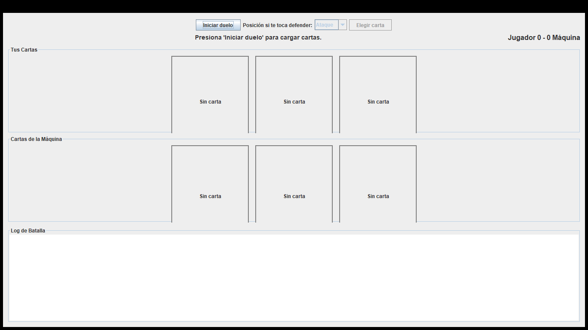
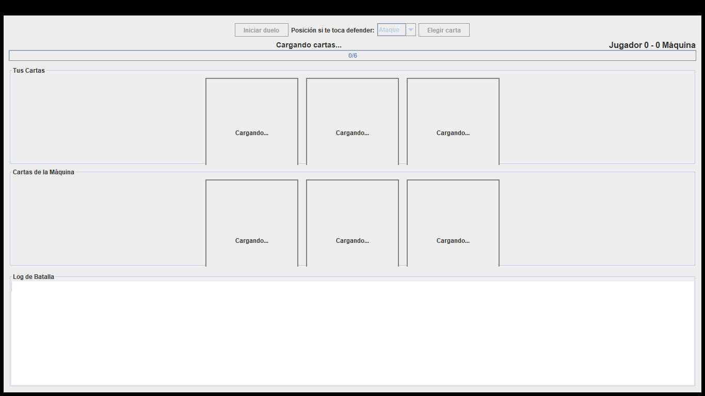
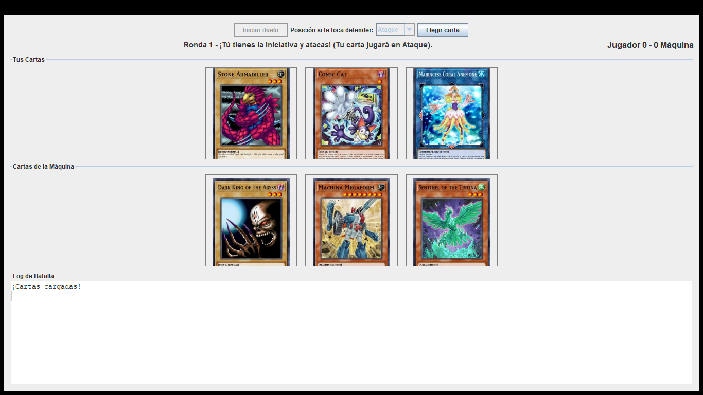
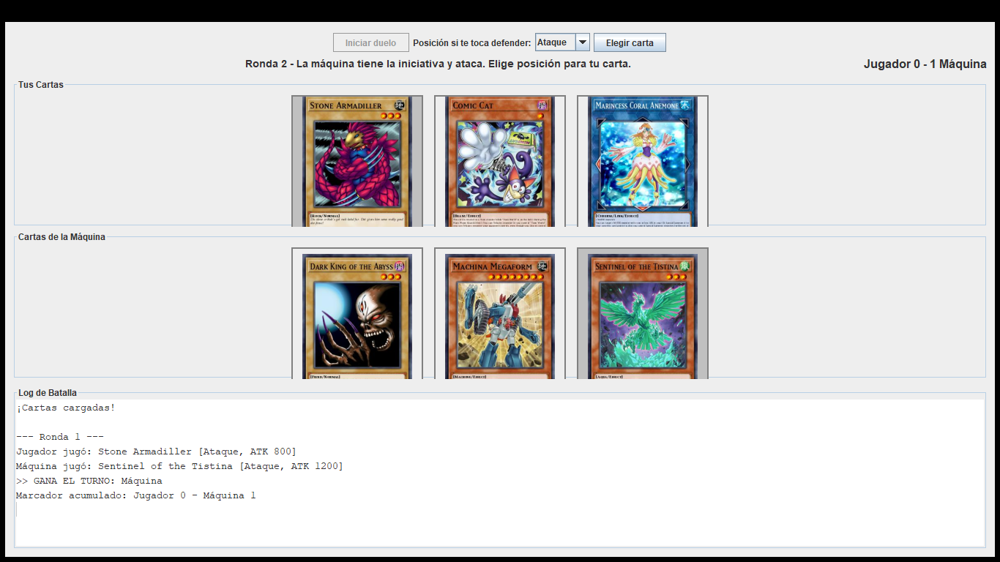

# Yu-Gi-Oh! Duel Lite

Mini-aplicación de escritorio (Java 11+, Swing) que simula un duelo entre el jugador y la máquina con cartas **Monster** obtenidas en vivo de la API [YGOProDeck](https://db.ygoprodeck.com/api-guide/) (`randomcard.php`).

## Participantes
- **Javier Andrés Muñoz Tavera** (2380421)
- **Juan David Turriago Orozco** (2477182)

## Ejecución

Requisitos: JDK 11 o superior y conexión a Internet.

**IntelliJ IDEA** (el módulo ya está configurado; usa estrictamente la librería del profesor `lib/json-20230227.jar`):
- Abrir la carpeta en IntelliJ.
- Ejecutar la clase `yugioh.Main`.

**Línea de comandos:**
```bash
# Desde la carpeta raíz del proyecto:
javac -encoding UTF-8 -d out -cp lib/json-20230227.jar $(find src/main -name "*.java")
java -cp "out;lib/json-20230227.jar" yugioh.Main
```

## Cómo se juega
1. **Iniciar duelo:** descarga 6 cartas Monster en paralelo. El juego no inicia hasta que las 6 tengan sus datos y su imagen listas.
2. El turno inicial (quién tiene la **iniciativa**) es aleatorio y se alterna cada ronda.
3. Marcas una de **tus cartas** usando el botón "Elegir" debajo de la carta.
4. Quien tiene la iniciativa ataca. Si la iniciativa es de la máquina, tú puedes elegir en el selector de arriba si juegas tu carta en **Ataque o Defensa**. La máquina elige su carta al azar.
5. Clic en **Elegir carta** para resolver el combate:
   - Ataque vs Ataque → mayor ATK.
   - Ataque vs Defensa → gana el atacante solo si su ATK > DEF del defensor.
   - *Empates:* ATK = ATK → gana el mayor DEF, y si persiste, gana quien tiene la iniciativa. ATK = DEF → gana el defensor.
6. El primero en llegar a 2 victorias gana el duelo. Cada carta se usa una vez y se oscurecerá al usarse.

## Diseño
El proyecto cumple todos los requisitos solicitados separando la lógica en paquetes (aplicando POO):
- **`yugioh.model`**: Clases de dominio (`Card`, `Position`).
- **`yugioh.api`**: `YgoApiClient` usa `java.net.http.HttpClient` nativo y la librería `json-20230227.jar`. Verifica que las cartas sean "Monster". Las descargas se hacen de forma **asíncrona y paralela** mediante `ExecutorService`, lo que reduce drásticamente el tiempo de carga sin bloquear el hilo principal.
- **`yugioh.logic`**: `Duel` maneja las reglas del juego independientemente de Swing y notifica a la interfaz usando el `BattleListener` (`onTurn`, `onScoreChanged`, `onDuelEnded`).
- **`yugioh.ui`**: Maneja los eventos (`ActionListener`) y la vista (`MainFrame`, `CardPanel`). Invoca la API a través de un `SwingWorker` para **no bloquear el EDT**, mostrando el progreso en la barra de carga nativa.

## Capturas de pantalla

### 1. Pantalla de inicio


### 2. Carga asíncrona (con barra de progreso)


### 3. Cartas listas para la batalla


### 4. Selección (Botón radio habilitado)


### 5. Resultado de la ronda en el Log

